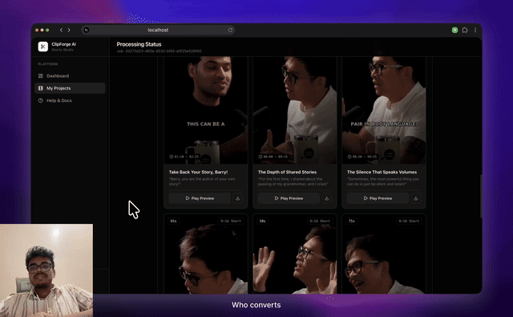
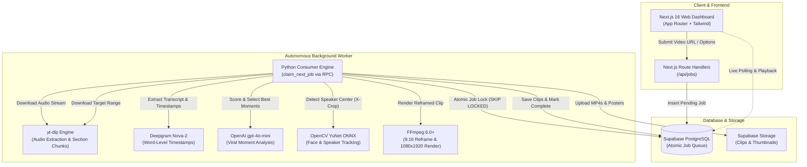

<h1 align="center">Clipper AI 🎬⚡</h1>

<p align="center">
  <b>Autonomous AI Video Repurposing Pipeline</b><br />
  Transform long-form podcasts and YouTube videos into high-engagement, viral vertical shorts (9:16) with automated speech-to-text, LLM moment detection, and computer vision speaker tracking.
</p>

[](https://nextjs.org/)
[](https://react.dev/)
[](https://www.typescriptlang.org/)
[](https://tailwindcss.com/)
[](https://python.org)
[](https://ffmpeg.org/)
[](https://opencv.org/)
[](https://deepgram.com/)
[](https://openai.com/)
[](https://supabase.com/)

---

## 📺 Demo Walkthrough

<p align="center">
  
</p>

<p align="center">
  🎬 <a href="https://pub-54b53270ca084c3cb6121e9adb5858a1.r2.dev/demo.mp4" target="_blank"><b>Watch Full-Resolution Direct Demo Video (MP4)</b></a> &nbsp;•&nbsp; 🌐 <a href="landing-page/index.html" target="_blank"><b>Open Interactive Landing Page</b></a>
</p>

---

## 🌟 Overview

**Clipper AI** is a production-ready, full-stack video automation engine designed to solve the content creator's bottleneck: converting 1–2 hour long-form videos into viral short-form clips for **TikTok, YouTube Shorts, and Instagram Reels**.

Instead of simple static cropping or random cuts, Clipper AI implements an end-to-end distributed system:
1. **Zero-Storage Audio Extraction**: Downloads lightweight audio streams directly from source URLs.
2. **Deepgram Nova-2 Transcription**: Transcribes spoken dialogue with word-level timestamps in seconds.
3. **LLM-Powered Semantic Analysis**: Evaluates conversational hooks, viral retention potential, and semantic boundaries using OpenAI `gpt-4o-mini`.
4. **Computer Vision Speaker Tracking**: Leverages an ONNX YuNet deep neural network (with Haar Cascade fallbacks) to center dynamic speakers in a 9:16 vertical crop.
5. **Precision Chunk Rendering**: Downloads only the targeted video intervals and encodes them to 1080x1920 with FFmpeg.
6. **Reactive Dashboard**: Real-time progress updates via Supabase and Next.js App Router.

---

## 🏗️ System Architecture



---

## 🚀 Key Features & Engineering Highlights

- **⚡ Distributed Job Queue with Atomic Locking**: Built on PostgreSQL `FOR UPDATE SKIP LOCKED` (`claim_next_job()` RPC), eliminating race conditions between multiple distributed workers.
- **🎯 Intelligent Viral Moment Detection**:
  - Automatically slices lengthy podcasts into overlapping windows (10–12 min) to process full 2-hour episodes without hitting token limits.
  - Custom structured output schema (`MomentAnalysis`) rating virality score (1–100), hook strength, narrative standalone value, and punchline coherence.
- **🧠 Computer Vision Smart Cropping**:
  - Employs deep-learning face detection (`face_detection_yunet_2023mar.onnx`) running on OpenCV DNN.
  - Calculates temporal speaker dominance, face area weighting, and profile orientation to ensure the active speaker stays centered in 9:16 vertical video.
- **💾 Zero-Waste Bandwidth Optimization**:
  - Never downloads full 4GB–10GB video files upfront.
  - Downloads **audio only** for speech processing, then selectively downloads **only the exact seconds** required for approved clips using `yt-dlp` download range filters.
- **🔥 Dynamic Animated Word-by-Word Captions**:
  - Leverages Deepgram Nova-2 word-level millisecond timestamps to render viral "Alex Hormozi" style animated captions into vertical video via Advanced SubStation Alpha (`.ass`) and FFmpeg.
  - Groups speech into short 3–4 word high-retention rhythmic bursts with real-time active word highlighting, high-contrast borders, and platform-safe vertical margins (protecting captions from TikTok/Reels UI buttons).
- **🎨 Sleek Dark-Mode Dashboard**:
  - Real-time stage progress (`audio` ➔ `transcribing` ➔ `moments` ➔ `rendering`).
  - Interactive clip player gallery with inline video preview, download triggers, and virality breakdown.

---

## 📂 Repository Structure

```
Clipper/
├── frontend/                     # Next.js 16 Web Application
│   ├── app/                      # Next.js App Router (Dashboard, Processing, Results)
│   │   ├── api/jobs/             # REST endpoints for job creation & retrieval
│   │   ├── dashboard/            # Video submission & recent projects overview
│   │   ├── processing/[id]/      # Live multi-stage pipeline monitor
│   │   └── results/[id]/         # Generated vertical clips showcase & player
│   ├── src/                      # UI components, layout shell, Supabase client
│   └── public/                   # Static assets & icons
│
├── worker/                       # Python Video Processing Engine
│   ├── models/                   # YuNet ONNX face detection weights
│   ├── bin/                      # Bundled FFmpeg & FFprobe binaries
│   ├── services/
│   │   ├── downloader.py         # yt-dlp section-targeted streaming
│   │   ├── transcriber.py        # Deepgram Nova-2 SDK integration
│   │   ├── analyzer.py           # OpenAI gpt-4o-mini structured analysis
│   │   ├── face_tracker.py       # OpenCV YuNet / Haar face tracking algorithms
│   │   ├── video_editor.py       # Dynamic FFmpeg crop & 1080x1920 encoder
│   │   └── supabase_service.py   # Database client, atomic claims & storage uploads
│   ├── config.py                 # Pydantic environment configuration
│   └── main.py                   # Worker lifecycle loop & error recovery
│
├── supabase/                     # Supabase & PostgreSQL Infrastructure
│   └── migrations/               # Production SQL migrations, triggers & RLS policies
│
└── BACKEND_SETUP.md              # Deep-dive backend & database architecture manual
```

---

## 🛠️ Tech Stack & Dependencies

| Layer | Technologies |
|---|---|
| **Frontend** | Next.js 16 (App Router), React 19, TypeScript, Tailwind CSS, Lucide Icons |
| **Backend & APIs** | Next.js API Routes, Supabase SSR, Edge Middleware |
| **Database & Queue** | Supabase (PostgreSQL), Custom SQL Queue Functions (`claim_next_job`), Storage Buckets |
| **Worker Engine** | Python 3.11+, Pydantic, HTTPX, yt-dlp |
| **AI & ML Models** | Deepgram Nova-2, OpenAI `gpt-4o-mini`, OpenCV YuNet (`.onnx`) |
| **Media Processing** | FFmpeg 6.0+ (H.264 / AAC / Dynamic Crop Filters), OpenCV (cv2) |

---

## ⚙️ Getting Started

### Prerequisites

- [Docker & Docker Compose](https://www.docker.com/products/docker-desktop/) *(recommended for instant cross-platform setup)*
- Alternatively, for local manual run:
  - **Node.js** 20.x or higher & **pnpm**
  - **Python** 3.11 or higher & **FFmpeg**
- **Supabase Account** ([supabase.com](https://supabase.com))
- **Deepgram API Key** ([deepgram.com](https://deepgram.com))
- **OpenAI API Key** ([platform.openai.com](https://platform.openai.com))

---

### 1. Database Setup (Supabase)

1. Create a free project on [Supabase](https://supabase.com).
2. Open the **SQL Editor** in your Supabase Dashboard.
3. Run the migration script located at [`supabase/migrations/20261121000000_init_clipforge.sql`](file:///d:/Projects/Clipper/supabase/migrations/20261121000000_init_clipforge.sql).
4. Under **Storage**, create a public bucket named `clips`.

---

### ⚡ Quickstart with Docker (Recommended)

Run the entire stack (Next.js web UI + Python AI video worker) with a single command on Windows, macOS, or Linux:

1. **Configure environment variables**:
   ```bash
   cp .env.example .env
   ```
   Fill in your Supabase credentials, Deepgram API key, and OpenAI API key in `.env`.

2. **Build the application**:
   ```bash
   docker-compose build --no-cache
   ```

3. **Start the application**:
   ```bash
   docker-compose up -d
   ```

4. **Stop the application**:
   ```bash
   docker-compose down
   ```

5. **Access the application**:
   - Open [http://localhost:3000](http://localhost:3000) in your browser.
   - The worker container will automatically claim pending jobs, track speakers, burn word-level captions, and push rendered clips to Supabase!

---

### 🛠️ Alternative: Manual Local Setup (Without Docker)

#### Frontend Configuration & Setup

```bash
cd frontend

# Install dependencies
pnpm install

# Configure environment variables
cp .env.example .env.local
```

Edit `.env.local`:
```env
NEXT_PUBLIC_SUPABASE_URL=https://your-project-ref.supabase.co
NEXT_PUBLIC_SUPABASE_ANON_KEY=your-supabase-anon-key
SUPABASE_SERVICE_ROLE_KEY=your-supabase-service-role-key
```

Run the development server:
```bash
pnpm dev
```
Open [http://localhost:3000](http://localhost:3000) in your browser.

---

### 3. Python Background Worker Setup

```bash
cd worker

# Create virtual environment
python -m venv venv

# Activate virtual environment
# Windows:
.\venv\Scripts\activate
# Linux/macOS:
source venv/bin/activate

# Install dependencies
pip install -r requirements.txt

# Configure environment variables
cp .env.example .env
```

Edit `.env`:
```env
SUPABASE_URL=https://your-project-ref.supabase.co
SUPABASE_KEY=your-supabase-service-role-key
DEEPGRAM_API_KEY=your-deepgram-api-key
OPENAI_API_KEY=your-openai-api-key
```

Run the worker:
```bash
python main.py
```

The worker will continuously poll for `pending` jobs, execute the pipeline, and push rendered clips directly to Supabase Storage.

---

## 🧪 Pipeline Walkthrough

```text
[Input URL] ➔ Download Audio (yt-dlp)
            ➔ Transcribe with Timestamps (Deepgram Nova-2)
            ➔ Analyze & Rank Clips (OpenAI gpt-4o-mini)
            ➔ Stream Target Slice (yt-dlp range)
            ➔ Detect Face Center & Track Speaker (OpenCV YuNet)
            ➔ Render 9:16 1080x1920 MP4 (FFmpeg)
            ➔ Upload & Stream to UI (Supabase Storage)
```

---

## 👤 Author & Contact

Developed by **Subhajit Ghosh**  
- **Website**: [orrin.site](https://orrin.site)
- **LinkedIn**: [linkedin.com/in/subhajitorrin](https://www.linkedin.com/in/subhajitorrin/)
- **GitHub**: [@subhajitorrin](https://github.com/subhajitorrin)
